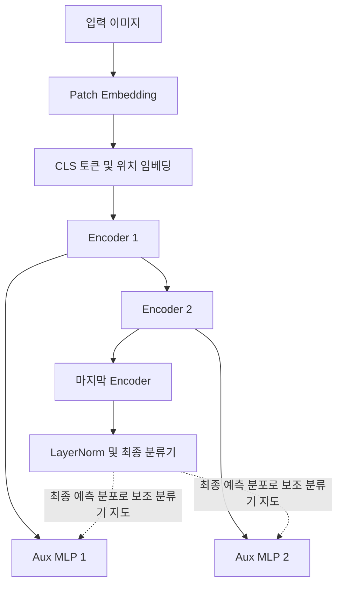

# SDiT: Self-Knowledge Distillation Image Transformer

이 저장소는 Vision Transformer(ViT)의 중간 인코더 표현에 보조 분류기를 연결하고, 최종 분류기의 예측을 이용해 보조 분류기를 함께 학습하는 SDiT(Self-Knowledge Distillation image Transformer)를 구현한다. 논문에서 제안한 구조와 손실을 살펴볼 수 있으며, 별도의 CIFAR-10 학습 스크립트도 포함한다.

> 논문의 주요 실험은 Pothole 이진 분류용 SDiT-2 실험이다. 저장소의 CIFAR-10 스크립트는 입력 크기 32×32, 클래스 10개로 구성된 별도 학습 설정이며, 논문에 보고된 Pothole 성능을 재현한 결과가 아니다.

## SDiT의 핵심 아이디어

일반적인 지식 증류는 별도의 사전 학습된 교사 모델이 필요하다. SDiT는 하나의 ViT 안에 최종 분류기와 여러 얕은 보조 분류기를 두고, 최종 분류기의 예측 분포를 보조 분류기의 학습에 사용한다. 이에 따라 별도의 교사 네트워크 없이 자기 지식 증류를 수행한다.

각 보조 분류기는 중간 Transformer 인코더의 `[CLS]` 표현을 받아 클래스 예측을 만든다. 논문은 이 보조 분류기에 추가 bottleneck 블록이나 Transformer 인코더를 넣지 않고 MLP를 사용한다.



깊이가 `N`인 모델에는 `N`개의 Transformer 인코더와 `N−1`개의 보조 분류기가 있다. 보조 분류기는 마지막 인코더를 제외한 각 인코더 블록의 출력 뒤에 연결된다.

## 구현 모델 구조

### 이미지에서 클래스 예측까지

1. **Patch embedding**: `Conv2d`의 커널과 stride를 patch 크기로 설정해 이미지를 패치 토큰으로 변환한다. 패치 수는 정사각형 입력에서 `(img_size / patch_size)²`이다.
2. **토큰 구성**: 학습 가능한 `[CLS]` 토큰을 앞에 붙이고 학습 가능한 위치 임베딩을 더한다.
3. **Transformer 인코더**: 각 블록은 LayerNorm, multi-head self-attention, MLP 및 residual 연결로 구성된다.
4. **보조 분류기**: 마지막 전 인코더들의 `[CLS]` 표현을 각각 AuxMLP에 전달한다. AuxMLP는 Linear → GELU → Linear → LayerNorm → 분류기 순서다.
5. **최종 분류기**: 마지막 인코더 출력의 `[CLS]` 표현을 LayerNorm과 Linear 분류기에 전달한다.

`SDiT.forward()`의 기본 반환 순서는 `(최종 로짓, 보조 로짓 1, ..., 보조 로짓 N−1)`이다. `return_features=True`이면 `(outputs, features)`를 반환하며, 두 튜플 모두 최종 항목이 아니라 **첫 항목이 최종 분류기/인코더 결과**다. 손실 함수 API는 보조 결과를 먼저, 최종 결과를 마지막에 받도록 정의되어 있으므로 호출 전에 순서를 맞춰야 한다. Feature Extraction 학습 스크립트는 이 순서 변환을 수행한다.

### 제공 모델 크기

세 모델 모두 기본 깊이는 12블록이다. 크기별 차이는 임베딩 차원과 attention head 수다. 파라미터 수는 `models/SDiT.py` 주석에 기재된 CIFAR-10 설정의 근삿값이다.

| 모델 | 임베딩 차원 | 인코더 깊이 | Attention head | 파라미터 수(근사) |
|---|---:|---:|---:|---:|
| `SDiT_Base` | 768 | 12 | 12 | 85.72M |
| `SDiT_Small` | 384 | 12 | 6 | 21.64M |
| `SDiT_Tiny` | 192 | 12 | 3 | 5.53M |

이 값은 코드 주석의 모델 설정에 대한 수치다. 실제 파라미터 수는 입력 클래스 수와 설정 변경에 따라 달라질 수 있다.

## 손실 함수

기호 `C`는 최종 분류기를, `i`는 각 보조 분류기를 나타낸다. `α`는 정답 레이블 손실과 증류 손실의 비율이다.

### 특징 추출 손실을 사용하지 않는 경우

각 분류기에 교차 엔트로피 손실을 적용하고, 보조 분류기에는 최종 분류기의 예측 분포를 기준으로 KL divergence를 더한다. 최종 분류기는 교사 역할을 하므로 자기 자신과 비교하는 KL 항은 없다.

\[
L_{\mathrm{no\ feature}} = \sum_{i=1}^{C}
\left[(1-\alpha)\,\mathrm{CE}(y_i,y_{\mathrm{truth}})
+ \alpha\,\mathrm{KL}(y_i,y_C)\right]
\]

구현은 KL 항에 temperature `T`를 적용하고 `T²`를 곱한다. 구현에서 최종 분류기의 확률 분포는 증류 대상이며 gradient를 통과하지 않는다.

### 인코더 특징 손실을 추가하는 경우

중간 인코더 특징을 최종 인코더 특징에 맞추는 제곱 L2 손실을 보조 분류기별로 추가한다. `λ`(`feature_weight`)가 이 항의 크기를 조절한다.

\[
L_{\mathrm{feature}}^{i}=\left\|F_{\mathrm{encoder}}^{i}-F_{\mathrm{encoder}}^{C}\right\|_2^2
\]

\[
L_{\mathrm{with\ feature}} = \sum_{i=1}^{C}
\left[(1-\alpha)\,\mathrm{CE}(y_i,y_{\mathrm{truth}})
+ \alpha\,\mathrm{KL}(y_i,y_C)
+ \lambda L_{\mathrm{feature}}^{i}\right]
\]

저장소의 `sdit_losses.py`는 특징 차이의 제곱을 원소별 평균이 아닌 합으로 계산한다. 따라서 `feature_weight`는 특징 텐서의 크기와 함께 조정해야 한다.

## 논문 실험 요약

논문 5.1절은 대규모 데이터 및 별도 사전 학습 모델 의존성을 줄이고, 사용자 데이터 중앙 집중에 따른 프라이버시 우려를 피할 수 있는 자기 지식 증류 구조로 SDiT를 소개한다. 2개 클래스인 Pothole 데이터에 맞춰 12개 인코더 대신 2개 인코더를 사용한 SDiT-2를 실험했다.

논문 6.2.2절의 Pothole 손실 비교 결과는 다음과 같다.

| SDiT-2 손실 설정 | 메인 분류기 정확도 | 보조 분류기 정확도 |
|---|---:|---:|
| 특징 손실 없음 | 93.05% | 92.08% |
| 특징 손실 포함 | 94.25% | 92.07% |

이 표에서 특징 손실 포함 설정은 메인 분류기 정확도가 1.20%p 높았고, 보조 분류기 정확도는 거의 같았다. 논문은 특징 손실 계산에 추가 시간이 들기 때문에 학습 시간 효율 측면에서 특징 손실을 사용하지 않는 설정이 유리하다고 설명한다. 이 결과는 논문의 Pothole 실험 결과이며 CIFAR-10 스크립트의 성능을 의미하지 않는다.

## CIFAR-10 학습 코드

저장소에는 손실 구성별 학습 스크립트가 있다.

| 파일 | 손실 |
|---|---|
| `Cifar10_SDiT_TrainNoFE.py` | 교차 엔트로피 + 자기 지식 증류 |
| `Cifar10_SDiT_TrainFE.py` | 위 손실 + 인코더 특징 손실 |

기본 설정은 이미지 32×32, patch 크기 4, 클래스 10개다. 기본 모델은 Base이며 `--model small` 또는 `--model tiny`로 변경할 수 있다. 데이터 경로의 기본값은 저장소 아래 `data/`이며, 스크립트는 CIFAR-10을 자동 다운로드하지 않는다. 데이터가 준비된 뒤 다음처럼 실행한다.

```bash
.venv/bin/python Cifar10_SDiT_TrainNoFE.py --device mps
.venv/bin/python Cifar10_SDiT_TrainFE.py --device mps
```

CPU 실행 예시는 다음과 같다.

```bash
.venv/bin/python Cifar10_SDiT_TrainNoFE.py --device cpu --model tiny
```

주요 기본값은 물리 배치 16, gradient accumulation 4회, 100 epochs다. AMP와 gradient checkpointing 옵션은 기본 활성화되어 있으며 `--no-amp`, `--no-checkpointing`으로 각각 끌 수 있다. 체크포인트 재개에는 `--resume <체크포인트 경로>`를 사용한다. 전체 옵션은 `--help`로 확인할 수 있다.

## 주요 파일

| 경로 | 역할 |
|---|---|
| `models/SDiT.py` | Patch embedding, Transformer 인코더, 보조/최종 분류기 및 모델 크기 정의 |
| `sdit_losses.py` | 특징 손실 유무에 따른 자기 지식 증류 손실 |
| `Cifar10_SDiT_TrainNoFE.py` | CIFAR-10 학습 코드(특징 손실 제외) |
| `Cifar10_SDiT_TrainFE.py` | CIFAR-10 학습 코드(인코더 특징 손실 포함) |
| `doc/졸업논문_최진욱.md` | 논문 전문, SDiT 구조와 손실식은 5.1절, 손실 비교는 6.2.2절 |
| `doc/졸업논문_최진욱.pdf` | 논문 PDF 원본 |

## 참고

- 최진욱, *딥러닝 모델 경량화 기술을 통한 모델 성능 개선과 SDiT 모델 기술 연구*, 홍익대학교 대학원, 2023년 8월.
- 본 README의 논문 요약과 결과는 저장소에 포함된 논문 5.1절 및 6.2.2절을 기준으로 작성했다.
